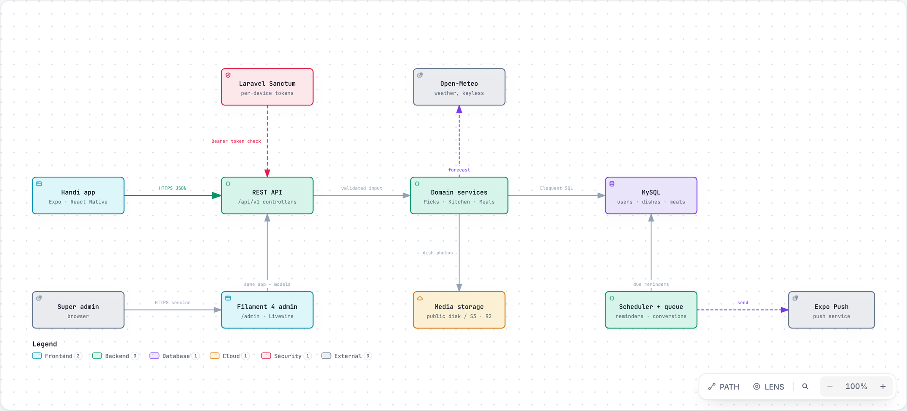
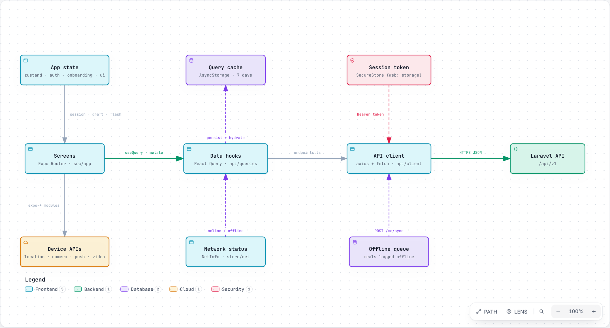
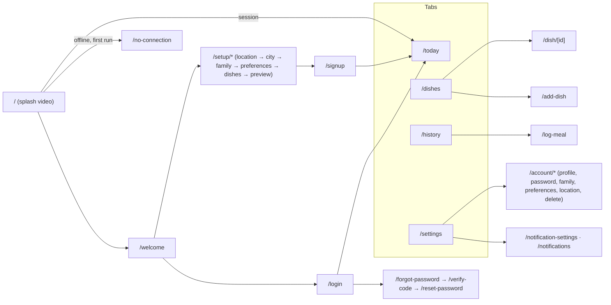
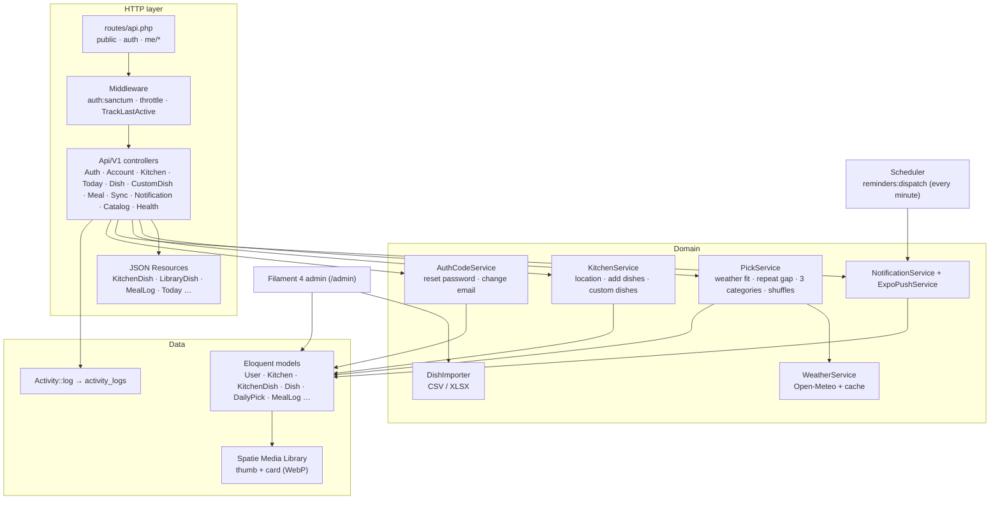
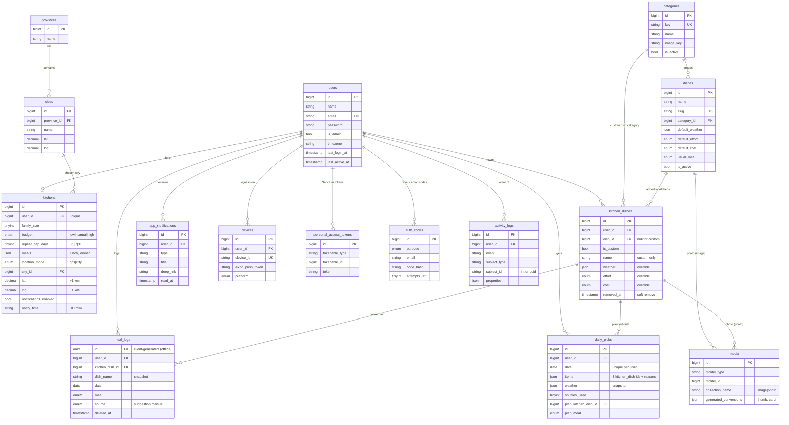
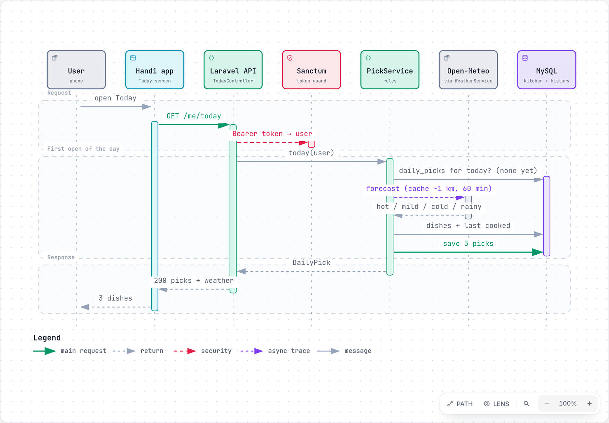
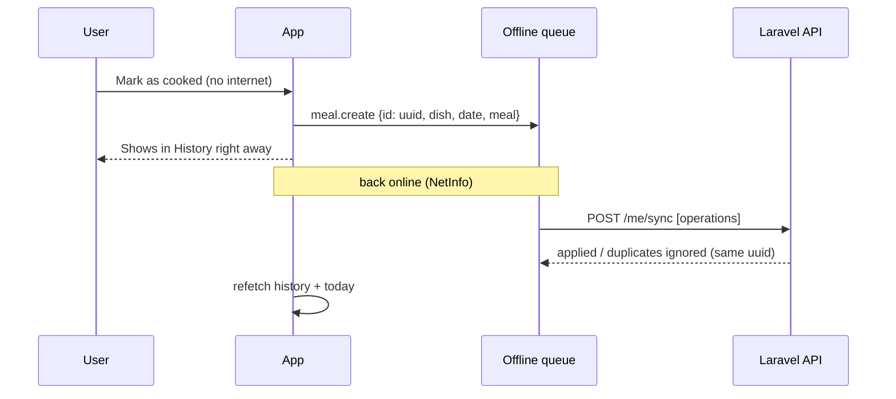
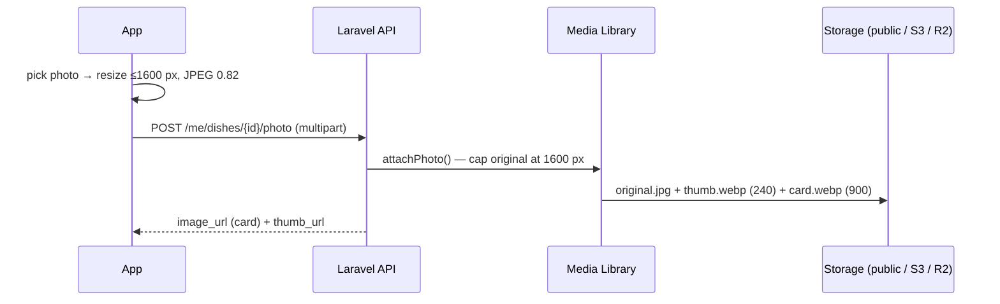

# Handi — What to Cook

> **Aaj kya pakaen?** Every morning Handi suggests **three dishes your family already cooks**, matched to **today's weather**, without repeating what you had recently.

| Part | Stack | Folder |
|---|---|---|
| Mobile app | Expo SDK 57 · React Native 0.86 · TypeScript · Expo Router | [`frontend/`](frontend) |
| REST API | Laravel 12 · PHP 8.2+ · Sanctum | [`backend/`](backend) |
| Admin panel | Filament 4 (in the same Laravel app) | [`backend/app/Filament`](backend/app/Filament) |
| Database | MySQL 8 / MariaDB (SQLite in tests) | [`backend/database`](backend/database) |
| Docs | API guide, Postman, OpenAPI, deployment | [`docs/`](docs) |

**Contents:**

- [System architecture](#system-architecture)
- [Frontend architecture](#frontend-architecture)
- [Backend architecture](#backend-architecture)
- [Database design](#database-design)
- [Key flows](#key-flows)
- [API overview](#api-overview)
- [Folder structure](#folder-structure)
- [Run it locally](#run-it-locally)
- [Configuration](#configuration)
- [Testing and quality](#testing-and-quality)
- [Deployment](#deployment)

---

## System architecture



> **Interactive version:** download [`docs/architecture/handi-system.html`](docs/architecture/handi-system.html) and open it in a browser. You can trace paths, focus nodes, zoom, and export PNG or SVG. All diagrams are made with [Archify](https://github.com/tt-a1i/archify). Their sources (`*.archify.json`) sit next to them, so they can be edited and re-rendered.

| Piece | What it does |
|---|---|
| **Handi app** | Expo app for Android, iOS and web. Talks only to the REST API over HTTPS with a Bearer token. |
| **REST API** (`/api/v1`) | Thin controllers that validate input, call domain services and return JSON Resources. |
| **Laravel Sanctum** | Issues one personal access token per phone, checked on every `me/*` request and revoked on logout. |
| **Domain services** | `PickService` (daily picks), `KitchenService`, `WeatherService`, `NotificationService`, `AuthCodeService`, `DishImporter`. |
| **MySQL** | Source of truth: users, kitchens, dishes, picks, meal history, notifications, activity log, media. |
| **Open-Meteo** | Free, keyless weather API. Results are cached per ~1 km and 60 minutes. |
| **Media storage** | Dish photos via Spatie Media Library on the `public` disk locally, or S3 / Cloudflare R2 in production. Two WebP sizes: `thumb` (240 px) and `card` (≤ 900 px). |
| **Filament 4 admin** | `/admin` for super admins: users with full history, activity log, dish library with CSV/Excel import, categories, cities. |
| **Scheduler + queue** | `reminders:dispatch` every minute (morning push at each user's time), media conversions, Telescope pruning. |
| **Expo Push** | Delivers the morning reminder to phones. |

---

## Frontend architecture



> **Interactive version:** [`docs/architecture/handi-frontend.html`](docs/architecture/handi-frontend.html)

**Layers**

1. **Screens** (`src/app`, Expo Router file-based routes). They render, handle input, and never call `fetch` directly.
2. **Data hooks** (`src/api/queries.ts`). React Query owns all server data: caching, refetching, optimistic updates and Undo.
3. **API client** (`src/api/client.ts` and `endpoints.ts`):
   - Axios for JSON, `fetch` for photo uploads.
   - One base URL from `EXPO_PUBLIC_API_BASE_URL`.
   - Errors become clear messages: a 422 shows the field error, a 5xx shows the server's message in development.
4. **App state** (`src/store`, zustand): session (`auth`), onboarding draft, network status (`net`), offline queue (`queue`), UI flags.
5. **Persistence:**
   - The React Query cache is saved to AsyncStorage for 7 days, so screens open instantly offline.
   - The session token is in SecureStore (localStorage on web).

**Routing map**



**UX rules built into the app**

- Every delete or remove asks first in a bottom sheet. The confirm button shows a spinner, then a success toast or Undo bar appears, or a red error toast with the server's reason.
- Going offline shows "You're offline" for 5 seconds. Cached data keeps working, and meals logged offline are queued with a client UUID and synced later through `POST /me/sync`.
- Photos are resized on the device (≤ 1600 px, JPEG 0.82) before upload.
- Design tokens live in `src/theme/tokens.ts` with the Poppins font, and the web build renders as a 440 px phone column.

---

## Backend architecture



| Concern | Where |
|---|---|
| Routes | `routes/api.php`: public catalog, auth with throttling, and signed-in `me/*` |
| Validation copy | `app/Support/Rules.php`, holding the exact messages the app shows |
| Daily picks | `app/Services/PickService.php` |
| Photos | `app/Models/Concerns/HasDishPhoto.php` (media collections, conversions, 1600 px cap) |
| Activity log | `App\Support\Activity::log()`, shown in the admin |
| Catalog cache | `app/Support/CatalogCache.php`; admin edits flush it so the app sees them immediately |
| API docs | Scramble at `/docs/api`; static copies in `docs/openapi.json` and `docs/handi-api.postman_collection.json` |
| Debugging | Laravel Telescope at `/telescope` (super admins; open locally) and `GET /api/v1/health` |

---

## Database design



**Design notes**

- **`kitchen_dishes` joins a user to the library.**
  - With `dish_id` set, it's a library dish. Its `weather`, `effort` and `cost` override the library defaults only when filled in.
  - With `is_custom = true`, it's the user's own dish.
  - "Remove" sets `removed_at`, so history is kept.
- **`meal_logs.id` is a UUID made on the phone**, so meals logged offline sync without duplicates. `dish_name` is a snapshot, so history survives renames and removals.
- **`daily_picks` has one row per user per day,** holding today's 3 picks, the weather snapshot, shuffles used and the planned dish.
- **`media`** (Spatie) stores one photo per dish (`singleFile`) plus its generated sizes.
- **`activity_logs.subject_id`** is a string, because subjects can be integer models or UUID meal logs.

Full table reference: [`docs/database.md`](docs/database.md).

---

## Key flows

### Opening Today (daily picks)



> **Interactive version:** [`docs/architecture/handi-today-sequence.html`](docs/architecture/handi-today-sequence.html)

**Pick rules** (`PickService`):

1. The dish fits today's weather, or is tagged `any`.
2. It wasn't cooked within the user's repeat gap.
3. The 3 picks come from 3 different categories.
4. The family's budget and meals are respected.

Shuffle makes a new set, up to 5 times a day; after that the API answers `429`. "Cook this today" saves the plan on the same `daily_picks` row.

### Logging a meal offline



### Photo upload



---

## API overview

All routes are under `/api/v1`. The full guide with request and response examples is in [`docs/api.md`](docs/api.md). Interactive docs are at `/docs/api`, and there's a Postman collection at [`docs/handi-api.postman_collection.json`](docs/handi-api.postman_collection.json).

| Group | Endpoints |
|---|---|
| Health | `GET /health` (database, cache and storage; 200 or 503) |
| Public catalog | `GET /library/dishes`, `/categories`, `/cities`, `/weather`, `/legal/{doc}`, `/image-prompt`; `POST /preview-picks` |
| Auth | `POST /auth/register`, `/auth/login`, `/auth/logout`, `/auth/password/{forgot,resend,verify,reset}` |
| Account | `GET/PATCH/DELETE /me`, `POST /me/email/verify`, `PUT /me/password` |
| Kitchen | `PATCH /me/kitchen`, `PUT /me/location`, `POST/DELETE /me/devices` |
| Today | `GET /me/today`, `POST /me/today/shuffle`, `PUT/DELETE /me/today/plan` |
| Dishes | `GET/POST /me/dishes`, `GET/PATCH/DELETE /me/dishes/{id}`, `POST /me/dishes/{id}/photo`, `/restore`, `DELETE …/overrides` |
| Custom dishes | `GET/POST /me/custom-dishes`, `PATCH/DELETE /me/custom-dishes/{id}`, `/restore` |
| History | `GET/POST /me/meals`, `PATCH/DELETE /me/meals/{id}`, `/restore`, `GET /me/stats`, `POST /me/sync` |
| Notifications | `GET /me/notifications`, `POST …/read-all`, `PATCH/DELETE …/{id}`, `/restore`, `GET/PUT /me/notification-settings`, `POST …/test` |

---

## Folder structure

```
handi/
├── backend/                     Laravel 12 API + Filament admin
│   ├── app/
│   │   ├── Http/Controllers/Api/V1/   REST controllers (docblocks feed the OpenAPI docs)
│   │   ├── Http/Resources/            JSON shapes
│   │   ├── Services/                  PickService, KitchenService, WeatherService, …
│   │   ├── Models/ (+ Concerns/)      Eloquent models, HasDishPhoto (media library)
│   │   ├── Filament/                  admin resources, widgets, pages
│   │   └── Support/                   Rules, Activity, CatalogCache, Media helpers
│   ├── database/migrations · seeders
│   ├── routes/api.php · console.php
│   └── tests/Feature                  110 Pest tests
├── frontend/                    Expo app
│   └── src/
│       ├── app/                 screens (Expo Router)
│       ├── api/                 client, endpoints, React Query hooks, types
│       ├── components/          UI kit (Txt, Button, Sheet, Toasts, Confirm…) + feature pieces
│       ├── lib/                 config, location, photo, notifications, offline queue, dates
│       ├── store/               zustand stores
│       └── theme/tokens.ts      design tokens
└── docs/                        api.md, database.md, deployment.md, architecture/ (diagrams)
```

---

## Run it locally

The project has two parts that run side by side: the **backend** (Laravel API + admin) and the **frontend** (Expo app). Start the backend first, then point the app at it.

**You need:** PHP 8.2+ with Composer 2 and MySQL 8 (Herd or Laragon on Windows) for the backend, and Node 22 with Android Studio (emulator) for the app.

### 1. Backend: API and admin

```bash
cd backend
composer install
copy .env.example .env              # macOS/Linux: cp .env.example .env
php artisan key:generate
# edit .env: DB_DATABASE=handi, DB_USERNAME, DB_PASSWORD, ADMIN_EMAIL, ADMIN_PASSWORD
# (optional demo user: DEMO_USER_EMAIL, DEMO_USER_PASSWORD), and create an empty "handi" database
php artisan migrate --seed          # tables + categories, dish library, cities, super admin, demo user
php artisan storage:link
php artisan serve --host=0.0.0.0 --port=8000
```

Check: http://localhost:8000/api/v1/health shows `"status": "ok"`, and http://localhost:8000/admin lets you sign in.

### 2. Frontend: mobile app

In a second terminal:

```bash
cd frontend
npm install
copy .env.example .env              # macOS/Linux: cp .env.example .env
# set EXPO_PUBLIC_API_BASE_URL (table below)
npx expo run:android                # first time: builds and installs the app on the running emulator
npx expo start                      # day to day; press "a" for Android, "r" to reload
```

| Where the app runs | `EXPO_PUBLIC_API_BASE_URL` |
|---|---|
| Android emulator | `http://10.0.2.2:8000/api/v1` |
| Phone on the same Wi-Fi | `http://<PC LAN IP>:8000/api/v1` |
| Web / same PC | `http://localhost:8000/api/v1` |
| Through ngrok | `https://<id>.ngrok-free.app/api/v1` (set `TRUSTED_PROXIES=*` in the backend) |
| Production server | `https://handi.hegemonicinc.com/api/v1` |

Restart with `npx expo start -c` after changing `.env`. Sign in with the demo user, or create an account through the app.

### Full guides

- **[Backend setup and running](backend/README.md#requirements)**: requirements, `.env`, database, Herd/ngrok, updating, troubleshooting.
- **[Frontend setup and running](frontend/README.md#requirements)**: emulator, real phone, web, EAS dev builds, troubleshooting.

**Local URLs:**

- Admin: http://localhost:8000/admin
- API docs: http://localhost:8000/docs/api
- Telescope: http://localhost:8000/telescope
- Health check: http://localhost:8000/api/v1/health

---

## Configuration

Every secret and setting lives in `.env`, which is git-ignored. `backend/.env.example` and `frontend/.env.example` document each key.

| Key | Purpose |
|---|---|
| `DB_*` | MySQL connection |
| `ADMIN_EMAIL`, `ADMIN_PASSWORD` | First super admin, created by the seeder |
| `MEDIA_DISK` | `public` locally, `s3` for S3 or Cloudflare R2 (fill in `AWS_*`) |
| `MEDIA_QUEUE_CONVERSIONS` | `true` makes photo sizes on the queue (needs `queue:work`) |
| `WEATHER_API_URL`, `WEATHER_CACHE_MINUTES` | Open-Meteo |
| `EXPO_PUSH_URL`, `EXPO_ACCESS_TOKEN` | Push notifications |
| `TELESCOPE_ENABLED` | Telescope on or off (off in production by default) |
| `TRUSTED_PROXIES` | `*` behind ngrok, Herd Share or a load balancer |
| `ADMIN_PATH` | Admin panel URL (default `/admin`), never linked from the website |
| `TELESCOPE_ALLOWED_EMAILS` | Admins allowed to open Telescope (default `admin@handi.test`) |
| `HANDI_SUPPORT_EMAIL` | Support address on the website and in emails |
| `HANDI_ANDROID_URL`, `HANDI_IOS_URL` | Store links on the website ("Coming soon" while empty) |
| `HANDI_LINK_TODAY`, `HANDI_LINK_RESET_PASSWORD` | Email buttons (default: the web app at `/app/...`) |
| `EXPO_PUBLIC_API_BASE_URL` (app) | The only app setting |

---

## Testing and quality

```bash
cd backend && php artisan test          # 110 Pest tests: every endpoint, pick rules, sync, admin, website, web app, emails
cd frontend && npm run typecheck && npm run lint
```

CI (`.github/workflows/ci.yml`) runs the backend tests on PHP 8.2 and the app's typecheck and lint on every push.

---

## Deployment

Production runs at **https://handi.hegemonicinc.com**: website `/`, the app in the browser `/app`, API `/api/v1`, admin `/admin`. See [`docs/deployment.md`](docs/deployment.md) for the server setup (Nginx, PHP 8.2+ FPM, scheduler, queue worker, S3/R2 storage) and for EAS builds of the app.
